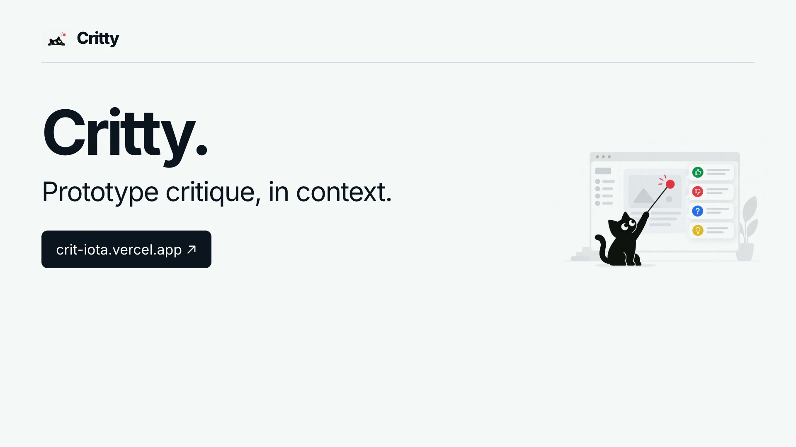

# Critty

**Prototype critique, in context.**

[Try Critty](https://crit-iota.vercel.app/)

Critty makes it easier to give useful feedback on a working prototype. Reviewers can point to a specific part of the interface and leave a comment where the issue appears, while the surrounding page and UI state remain part of the conversation.

It works on interactive websites and prototypes, including ones made with tools such as Lovable. Feedback can be marked as **Keep**, **Change**, **Question**, or **Idea**. Teams can also receive Slack notifications when new comments arrive.

## Why I made it

Feedback in a separate document often leaves the team guessing: Which screen? Which button? What was open at the time? Critty puts the critique beside the interface so it is easier to understand and act on.

## Explore

- [Open the live app](https://crit-iota.vercel.app/)

This is a public project showcase. The application source code lives in a separate private repository.
